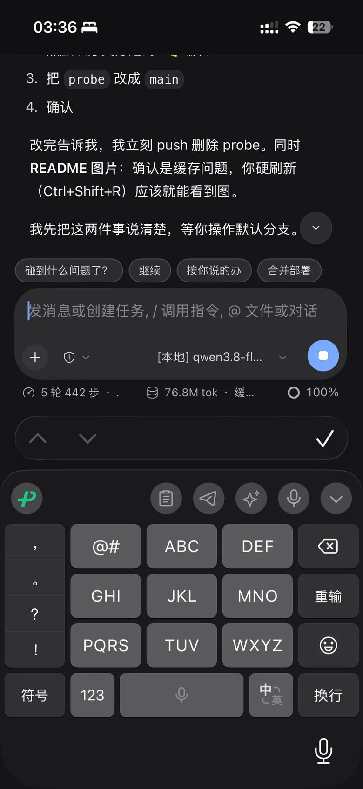
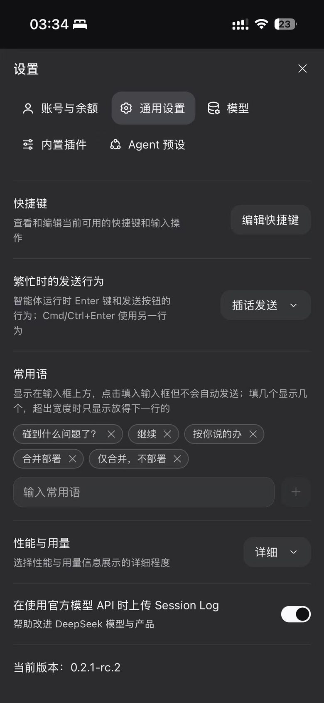
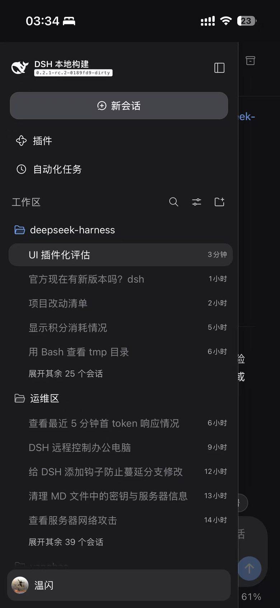

# DeepSeek Harness — 移动端优化版（0.2.1-rc.2）

> 基于官方 [DeepSeek Harness](https://github.com/deepseek-ai/deepseek-harness) **0.2.1-rc.2**（2026-10-20 快照）的本地改造，重点打磨 **Web 端在手机/平板上的体验**。

English | [中文](README.zh.md)

---

## 这个故事是怎么开始的

官方 DeepSeek Harness 是一个出色的桌面/网页 Agent 工作台——**三栏布局、鼠标键盘驱动、信息密度高**。但它的 Web 端在手机上一打开就露怯：

- 侧边栏把整个屏幕占掉，会话列表和聊天区挤在一起，点都点不准；
- 触屏第一下点击经常没反应，要再点一下才打开会话；
- 拖动会话行、双击重命名这些鼠标操作在手指上变成误触灾难；
- 聚焦输入框会自动放大页面、弹出软键盘把界面顶飞；
- 打开会话时键盘自己弹出来，还没打字就先被键盘糊一脸。

**在电脑前用没什么，一出门用手机就难受。** 于是我把这个「出门也要能用的 Web 端」当成一个正经项目来改：不是打补丁，是把移动端当一等公民重做。

---

## 改了什么

### 📱 第一波：移动端布局重构（2026-10-22）

- **浮动侧边栏抽屉**：窄屏下侧边栏不再占据网格轨道，改为从左侧滑入的抽屉（≈85vw、上限 420px），带遮罩点击关闭；
- **顶部 Logo 入口**：窄屏下左上角常驻 Logo，点一下开抽屉；会话行浮层不再误触重开抽屉；
- **打开会话自动收起抽屉**：点会话 → 抽屉收起 → 直接看内容，一步到位；
- **会话行交互重做**：禁用拖拽、移除双击重命名（触屏误触源），单击稳定打开；
- **触屏判定重写**：`pointerdown` 立即打开改为「位移 <10px 的 tap 才算点击」，滚动不误触；
- **会话归档按钮**：右上角 header 增加归档/取消归档，手机也能管理会话。

### 📱 第二波：移动端细节打磨（2026-10-23）

- **整页右滑呼出抽屉**：任意区域右滑（≥70px）呼出抽屉，替代被浏览器「返回上一页」抢占的左边缘热区；
- **打开会话不自动弹键盘**：触屏设备打开会话/清空阻塞不再自动聚焦输入框，不糊脸；
- **模型菜单不弹键盘**：触屏下跳过搜索框自动聚焦，输入字号地板 16px 防 iOS 聚焦放大；
- **全局防缩放**：viewport 禁缩放 + 触屏字号 floor 16px，聚焦不再页面变宽；
- **滚动误触修复**：会话/分组/搜索行统一接入 tap-vs-scroll 判别。

### 🖥 窄屏设置页响应式（2026-10-23）

- 720px 断点下设置页改单栏纵向布局，标签条横向 wrap，账号卡片不挤压文案；
- 390/320/1280 三档实测无溢出。

### ⚡ 首屏性能（2026-10-23）

- 静态加载骨架 + 引导插图/插件预览改按需 chunk，首屏不再白屏等待。

### 🔧 后端增强（可选，不影响移动端使用）

> 以下属于 Host/后端侧增强，与移动端适配无关；不需要可以关闭或忽略。

| 项 | 说明 |
|---|---|
| 会话冷读缓存可配置 | `session-persistence-jsonl` 的冷读缓存大小改为可配置（`coldLogCacheSize` / `preparedSessionCacheSize`），加快长会话打开 |
| 网关积分透传显示 | LLM 适配层捕获网关透传的每轮 `creditsUsed`，在 Web 端运行行/结算行以金币图标 + 两位小数显示（仅当所用模型路由透传积分时可见） |
| 会话亲和开关 | pi-ai 适配层提供会话亲和兼容开关 |

---

## 变更流水账（2026-10-20 → 2026-10-23）

| 日期 | 提交 | 内容 |
|---|---|---|
| 10-20 | `59f26cda` | 新建会话复用当前工作区空白会话，不再丢失输入草稿 |
| 10-20 | `bcea2b18` | context meter 增加紧凑上下文快捷操作 |
| 10-20 | `af4c853d` | 打开会话/新建会话自动收起移动端侧边栏 |
| 10-20 | `20c870ca` | 移除会话标题双击重命名，避免触屏误触弹窗 |
| 10-21 | `510c7366` | pi-ai 适配层增加会话亲和兼容开关 |
| 10-21 | `9e7ed294` | 终端失败一键 Continue 重试 |
| 10-22 | `a92b9b0b` | 手机端禁用会话行拖拽，单击稳定打开会话 |
| 10-22 | `1e587709` | 账号菜单显示构建时间；拖拽禁用加固为 hover+fine pointer |
| 10-22 | `8bdb5a91` | 触屏第一下点击即打开会话/分组，无需第二下 |
| 10-22 | `ce58f0fa` | 会话 header 增加归档/取消归档按钮 |
| 10-22 | `1dd11727` | **手机第一波**：浮动侧边栏抽屉、顶部 Logo、单一归档操作 |
| 10-23 | `562e7360` | 输入区在会话打开卡住/失败时不再永久消失 |
| 10-23 | `c03645f5` | composer 上下文窗口快捷标签 + 快捷短语 |
| 10-23 | `507f9ccb` | 触屏点输入区工具栏按钮不再弹出软键盘 |
| 10-23 | `c3358336` | 上下文窗口标签修复 user 层 provider 映射 |
| 10-23 | `74169fc8` | 首屏静态骨架 + 图片按需 chunk |
| 10-23 | `6864b3fa` | **手机第二波**：防聚焦缩放/右滑抽屉/滚动误触/触屏键盘 |
| 10-23 | `3baa7562` | 常用语标签背景不透明 |
| 10-23 | `129b13c7` | 窄屏设置页响应式 |
| 10-23 | `f0752a65` | 会话冷读缓存可配置（后端，可选） |
| 10-23 | `fcaf5b3d` | 显示网关透传的每轮积分消耗（后端，可选） |
| 10-23 | `21a67494` | 积分捕获惰性求值修复（后端，可选） |
| 10-23 | `0189fd9c` | 运行中积分改读本轮控制节点（后端，可选） |
| 10-23 | `104efc66` | 积分改为金币图标 + 两位小数（后端，可选） |

> 说明：merge commit 已折叠为线性历史；`scripts/quick-test.sh`（个人提速脚本）未包含在本仓库。

---

## 现在长什么样

### 手机上的样子（实拍，1179×2556）







窄屏下首页干净、无侧边栏占位；触屏交互按「先稳定再顺手」的顺序打磨（详见上方变更流水账）。

---

## 快速上手

```bash
# 安装依赖（需要 Node ^22.19 || >=24 和 pnpm）
pnpm install

# 构建
pnpm run build

# 启动 Web 端（浏览器打开提示的地址）
pnpm dsh web
```

移动端适配在 `≤1024px` 视口生效；用浏览器开发者工具的手机模拟（如 iPhone 14 / Pixel 7）即可体验。

---

## 与官方的关系

- **基线**：官方 `0.2.1-rc.2`（`eddb3ba5`，2026-10-20 快照）
- **改动方式**：直接改造官方 Web 客户端源码（`packages/client/*`）与少量后端
- **未改动**：核心 Agent 循环、Session 格式、SDK、桌面端

---

## License

MIT（与官方一致），见 [LICENSE](LICENSE)。
